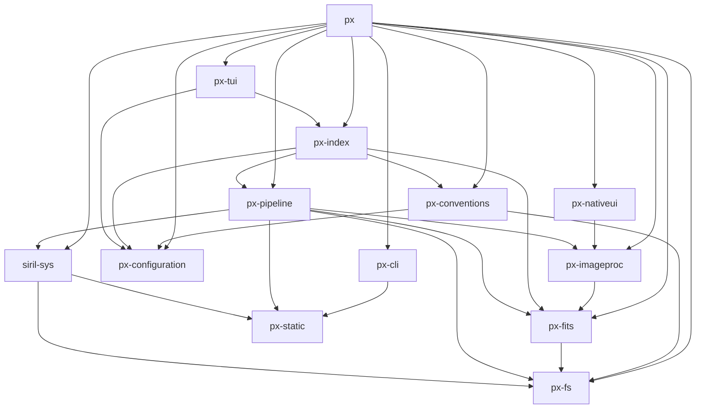

# Crate Dependency Graph

This document shows how the `px-*` crates (and `siril-sys`) depend on each other within the
workspace. Regenerate the edges with:

```sh
for c in crates/*/; do
  echo "$(basename "$c"): $(sed -n '/^\[dependencies\]/,/^\[[a-z]/p' "$c/Cargo.toml" \
    | grep -oE '^(px-[a-z]+|siril-sys)' | sort -u | tr '\n' ' ')"
done
```

## Graph



## Dependency Table

| Crate | Depends On |
|---|---|
| `px` | `px-cli`, `px-configuration`, `px-conventions`, `px-fits`, `px-fs`, `px-imageproc`, `px-index`, `px-nativeui`, `px-pipeline`, `px-tui`, `siril-sys` |
| `px-cli` | `px-static` |
| `px-conventions` | `px-configuration`, `px-fs` |
| `px-fits` | `px-fs` |
| `px-imageproc` | `px-fits` |
| `px-index` | `px-configuration`, `px-conventions`, `px-fits`, `px-pipeline` |
| `px-nativeui` | `px-imageproc` |
| `px-pipeline` | `px-fits`, `px-fs`, `px-imageproc`, `px-static`, `siril-sys` |
| `px-tui` | `px-configuration`, `px-index` |
| `siril-sys` | `px-fs`, `px-static` |
| `px-configuration` | *(none)* |
| `px-fs` | *(none)* |
| `px-static` | *(none)* |

## Leaf Crates (no internal dependencies)

- `px-configuration` — project/workspace config types
- `px-fs` — filesystem utilities
- `px-static` — static assets / embedded resources

## The two processing crates

`px-fits` and `px-imageproc` are deliberately separated, and the boundary is worth stating because
it is easy to erode:

- **`px-fits`** is a pure format crate (ADR 006). It reads and writes FITS bytes and has no opinion
  on what the pixels mean photographically.
- **`px-imageproc`** sits on top and owns everything that interprets pixel values (ADR 007):
  calibration, debayering, star detection, registration, warping, stacking, statistics, and the
  memory-budgeted block scheduler those depend on.

`px-pipeline` composes them into the five pipelines and can execute each one in either engine —
`siril-sys` or the native path — which is why it depends on both.

`FitsExt` living in `siril-sys` rather than `px-fits` is a known wart (ADR 007, D5): every engine
needs it, and only one of them is Siril.
